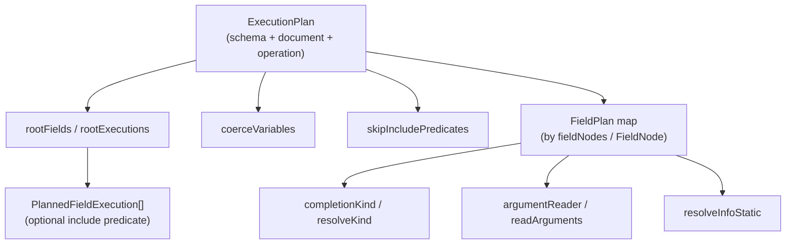
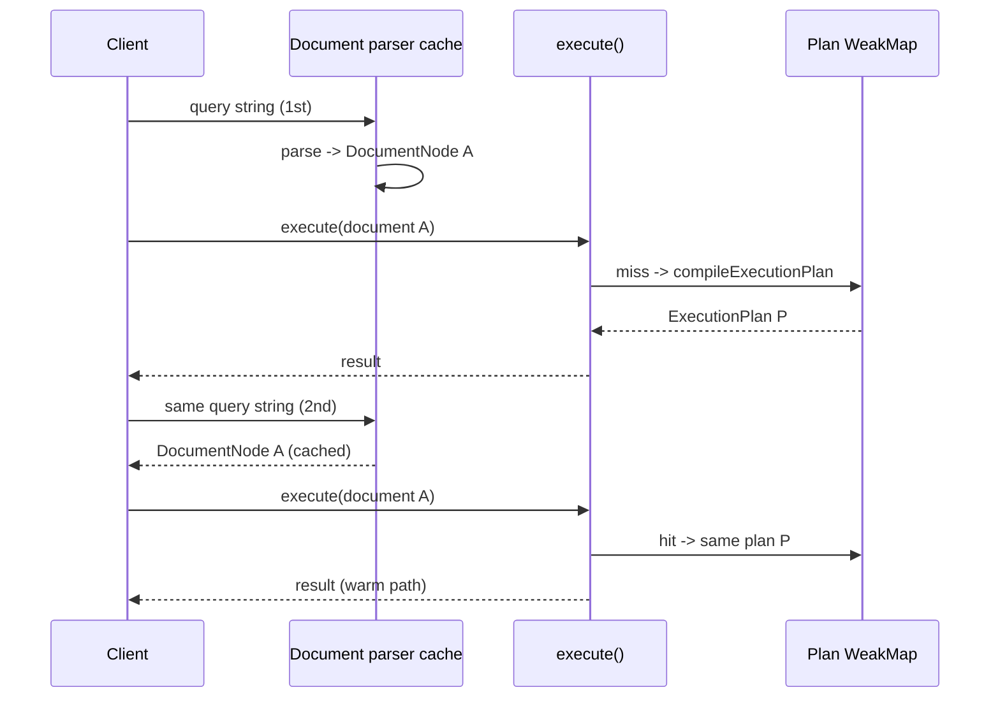

---
description:
  Planned execution in @graphql-tools/executor: compile once per document, reuse on warm executes,
  and why it helps.
---

import { Callout } from '@theguild/components'

# Planned execution

`@graphql-tools/executor` can compile a cacheable **execution plan** for a GraphQL operation and
reuse it across repeated `execute` / `executeSync` calls. The plan is an in-memory structure
interpreted by the default executor on the warm path.

On a warm hit, field collection, type classification, variable coercion, resolveInfo statics, and
safe argument reads are already prepared, so each request does less AST work.

## What is compiled

For an eligible `(schema, document, operationName)`, `compileExecutionPlan` builds an
`ExecutionPlan` that holds:

| Piece                | Role                                                                                                                                                    |
| -------------------- | ------------------------------------------------------------------------------------------------------------------------------------------------------- |
| **Field maps**       | Pre-collected root / subfield maps (or a union over `@skip`/`@include` bool extremes)                                                                   |
| **`FieldPlan`**      | Per-field static facts: return type, completion/resolve kinds, leaf / list-of-leaf facts, `skipIsTypeOf`, planned `resolveInfoStatic`, argument readers |
| **Coercers**         | Plan-bound `coerceVariables` (empty / builtin-leaf / hoisted input-object closures) and per-field argument readers                                      |
| **Skip / include**   | Path-aware predicates on planned field executions when variables gate fields or fragments                                                               |
| **`rootExecutions`** | Bound root (and subfield) execution lists the warm path walks instead of re-collecting                                                                  |

Documents that use `@defer` / `@stream` still compile per-field plan facts where useful; the
incremental interpreter remains the runtime for patches.




## Document parser cache (compile once)

Plans are cached in a `WeakMap` keyed by **`DocumentNode` identity** (then schema, then operation
name). That pairs naturally with a **document parser cache** (for example Yoga's
`useParserAndValidationCache`, or Envelop's parser-cache plugin): the same query string keeps
returning the same `DocumentNode`, so the plan is compiled on the first execute and reused on every
later request for that document.



<Callout type="info">
  Without a parser cache, each `parse(source)` allocates a **new** `DocumentNode`. The plan cache
  cannot hit across those identities, so every request pays compile cost again. Pairing parser cache
  + plan cache is how servers get the warm path in production.
</Callout>

Cold first-hit (compile + execute) can be slower than classic execute on some documents; the wins
below are for the **warm** path after the plan is cached. Default mode is speculative: classic
execute on a cache miss, with a background compile so later hits are warm.

## How to use it effectively

1. **Keep document identity stable**: use Yoga / Envelop parser cache, persisted queries, or any
   layer that returns the same `DocumentNode` for the same source.
2. **Call the default executor**: `execute` / `executeSync` / `normalizedExecutor` compile and
   attach the plan automatically via `buildExecutionContext`. You can also call
   `compileExecutionPlan` yourself to warm the cache.
3. **Prefer stable schemas**: plans close over field configs; if you mutate a schema object in
   place, call `clearExecutionPlanCache(document)` (or use a new schema identity).
4. **No API change required**: eligible operations get the warm path by default; ineligible or
   error cases fall back to classic coerce / collect behavior with the same GraphQL error shapes.

```ts
import { compileExecutionPlan, execute } from '@graphql-tools/executor'

// Optional: warm once at startup for known operations
compileExecutionPlan({ schema, document })

// Later requests with the same DocumentNode reuse the plan
const result = await execute({ schema, document, variableValues })
```

## Why it helps (benchmarks)

Measured on interleaved vitest benches vs `master` (Node 22, same machine). Numbers are warm-path
throughput deltas after the plan is cached.

### Warm classics (plan amortizes collect / resolveInfo / args)

| Bench                                          | Approx. delta vs master |
| ---------------------------------------------- | ----------------------: |
| Dense synchronous float list                   |              **~+112%** |
| Default-resolver property bag (400 Int fields) |               **~+33%** |
| Many repeated fields                           |               **~+38%** |
| Asynchronous list field                        |               **~+22%** |
| Nested default-resolver objects                |               **~+16%** |
| Collect stable (unused variables)              |               **~+16%** |
| Synchronous list field                         |           ~flat (noise) |

**Why:** `FieldPlan` and `rootExecutions` remove repeated field collection, type classification,
resolveInfo static setup, and safe argument coercion on every request.

### Hoisted variable coercers

| Bench                                    |                     Approx. delta |
| ---------------------------------------- | --------------------------------: |
| Coerce+execute heavy nested input-object |                     **~+67-74%** |
| Coerce-only heavy nested input-object    | **~+130-140%** (stage isolation) |
| Coerce+execute small nested input-object |        ~flat (execute-dominated) |

**Why:** plan-bound per-input-type `InputValueCoercer` closures avoid rebuilding coercion work
through `getVariableValues` on the happy path; error shapes still match graphql-js via diagnose /
fallback.

### Skip / include predicates

| Bench                                      | Approx. delta vs master |
| ------------------------------------------ | ----------------------: |
| Dense `@skip` / `@include` variable fields |            **~+63-67%** |

**Why:** on top of master's collect-layer field predicates, the plan path keeps union
`rootExecutions` / subfield executions and filters with compiled include predicates instead of
re-`collectFields` every time.


## API surface

| Export                    | Purpose                            |
| ------------------------- | ---------------------------------- |
| `compileExecutionPlan`    | Compile or return the cached plan  |
| `getExecutionPlan`        | Lookup without compiling           |
| `clearExecutionPlanCache` | Drop cached entries for a document |
| `isExecutionPlan`         | Type guard for a successful plan   |

See the package source (`packages/executor/src/execution/plan.ts`) for the full `ExecutionPlan` /
`FieldPlan` TypeScript shapes.
