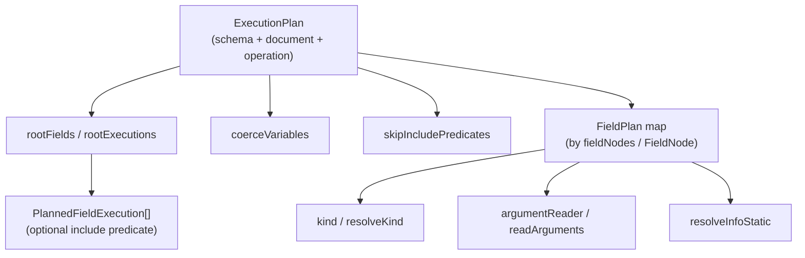
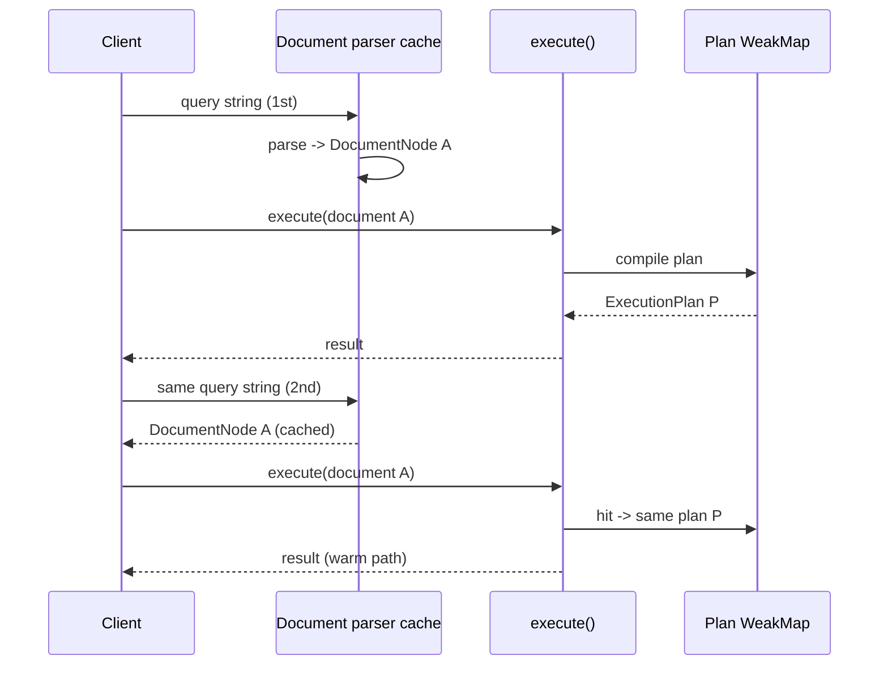

import { Callout } from '@theguild/components'

# Planned execution

`@graphql-tools/executor` compiles a cacheable **execution plan** for a GraphQL operation and reuses
it across repeated `execute` / `executeSync` calls. The plan is an in-memory structure the executor
interprets on the warm path.

On a warm hit, field collection, type classification, variable coercion, resolveInfo statics, and
safe argument reads are already prepared, so each request does less AST work.




## How to use it

1. **Keep document identity stable**: use Yoga / Envelop parser cache, persisted queries, or any
   layer that returns the same `DocumentNode` for the same source.
2. **Call `execute`**: public `execute` / `executeSync` / `normalizedExecutor` get-or-compile a plan
   from `schema` + `document` (+ optional `operationName`). Or compile once and pass the plan into
   `execute` for warm reuse.
3. **Treat schemas as immutable for plan cache**: the plan cache keys on schema **identity**. After
   changing resolvers or scalars, use a new schema object (or a new `DocumentNode`).
4. **Treat plans as opaque**: an `ExecutionPlan` is a handle for the executor — not a public data
   structure you inspect or edit. **Do not mutate that object.** Prefer
   `execute({ schema, document })` unless you need explicit compile + plan-only reuse.

```ts
import { compileExecutionPlan, execute, isExecutionPlan } from '@graphql-tools/executor'

// Automatic: same DocumentNode identity → get-or-compile, then execute
const result = await execute({ schema, document, variableValues })

// Manual: compile once, then pass the opaque plan into execute
const plan = compileExecutionPlan({ schema, document })
if (isExecutionPlan(plan)) {
  // Pass the plan as-is. Do not mutate it; the executor owns its contents.
  const warm = await execute({ plan, variableValues })
}
```

Passing a precompiled `plan` alone trusts that plan's schema / document / operation. Do not also
pass `schema` / `document` / `operationName` on the same call.

## What is compiled

For an eligible `(schema, document, operationName)`, public `execute` get-or-compiles an
`ExecutionPlan`. The warm interpreter holds:

| Piece                | Role                                                                                                                                                |
| -------------------- | --------------------------------------------------------------------------------------------------------------------------------------------------- |
| **Field maps**       | Pre-collected root / subfield maps (or a union over `@skip`/`@include` bool extremes)                                                               |
| **`FieldPlan`**      | Per-field static facts discriminated by `kind` (`leaf` / `leafList` / `object` / `abstract` / `list`), plus resolve kind, `resolveInfoStatic`, args |
| **Coercers**         | Plan-bound `coerceVariables` (empty / builtin-leaf / hoisted input-object closures) and per-field argument readers                                  |
| **Skip / include**   | Path-aware predicates on planned field executions when variables gate fields or fragments                                                           |
| **`rootExecutions`** | Bound root (and subfield) execution lists the warm path walks instead of re-collecting                                                              |

Documents that use `@defer` / `@stream` still compile per-field plan facts where useful; the
incremental interpreter remains the runtime for patches.

## Document parser cache

Plans are cached in a `WeakMap` keyed by **`DocumentNode` identity** (then schema, then operation
name). Pair with a **document parser cache** (for example Yoga's `useParserAndValidationCache`, or
Envelop's parser-cache plugin): the same query string keeps returning the same `DocumentNode`, so
the plan compiles once and is reused on later requests for that document.



<Callout type="info">
  Without a parser cache, each `parse(source)` allocates a **new** `DocumentNode`. The plan cache
  cannot hit across those identities. Pairing parser cache + plan cache is how servers stay on the
  warm path in production.
</Callout>

## Why planned beats classic

**Classic** re-walks the operation AST on every request: collect fields, classify types, build
resolveInfo statics, coerce variables, and read arguments. **Planned** does that work once when the
plan is compiled, then the warm path walks bound field executions and uses prepared readers and
kinds. List shapes also take thinner walks (leaf lists, object lists) and settle async work closer
to the field that produced it.

The first request for a `(schema, document, operationName)` pays compile cost. After that, warm
planned execute stays ahead of classic on the same document — especially for list-heavy and nested
default-resolver shapes — as long as document identity is stable (see parser cache above).

### Benchmarks (planned warm vs classic)

Process-isolated microbenches on Node 22 (separate process per side, warm plan). Deltas are
**planned faster than classic** on the same tip:

| Bench                                      | Approx. planned vs classic |
| ------------------------------------------ | -------------------------: |
| Synchronous leaf list (1000)               |                    ~+200%+ |
| Asynchronous leaf list (1000)              |                     ~+100% |
| Asynchronous root fields (1000)            |                      ~+80% |
| Nested default-resolver objects (200)      |                     ~+130% |
| Dense `@skip` / `@include` variable fields |                      ~+45% |

HTTP / federation end-to-end rows are dominated by network and gateway work; executor planning still
hits when the document is cached, but wall-clock gains there are smaller than the microbenches
above.

## Testing

Correctness lives under `packages/executor/src/execution/__tests__/`:

| Area                         | Where                                                                 |
| ---------------------------- | --------------------------------------------------------------------- |
| Core GraphQL semantics       | `__tests__/core/` (run planned by default)                            |
| Classic dual-mode            | Same suite with `GRAPHQL_TOOLS_EXECUTOR_PLANNING=0`                   |
| Plan compile / cache / reuse | `__tests__/plan/` (e.g. `execution-plan-test.ts`, dual-mode planning) |
| Lists, NonNull, incremental  | Neighboring suites under `__tests__/`                                 |

```sh
npm run test:executor:core         # planned (default)
npm run test:executor:core:classic # classic interpreter only
npm run test:executor:dual-mode    # both (also run in CI)
```

CI runs dual-mode so planned and classic stay aligned on the core suite. Prefer those scripts over
hand-rolled mode switches in application code.
