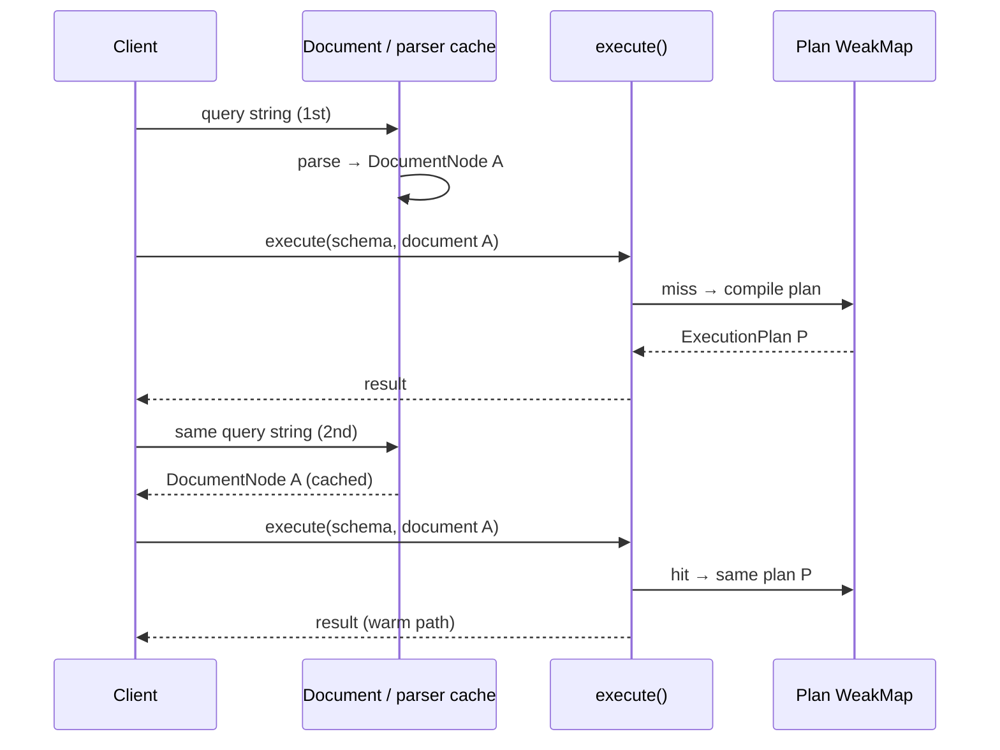

import { Callout } from '@theguild/components'

# Planned execution

`@graphql-tools/executor` compiles a cacheable **execution plan** for a GraphQL operation and reuses
it across repeated `execute` / `executeSync` calls. The plan is an in-memory structure the executor
interprets on the warm path.

On a warm hit, field collection, type classification, variable coercion, resolveInfo statics, and
safe argument reads are already prepared, so each request does less AST work.

## How to use it

1. **Keep document identity stable**: use Yoga / Envelop parser cache, persisted queries, or any
   layer that returns the same `DocumentNode` for the same source.
2. **Call `execute`**: public `execute` / `executeSync` / `normalizedExecutor` get-or-compile a plan
   from `schema` + `document` (+ optional `operationName`). Or compile once and pass the plan into
   `execute` for warm reuse.
3. **Treat schemas as immutable for plan cache**: the plan cache keys on schema **identity**. After
   changing resolvers or scalars, use a new schema object (or a new `DocumentNode`).
4. **Treat plans as opaque**: an `ExecutionPlan` is a handle for the executor — not a public data
   structure you inspect or edit. **Do not mutate that object.** Prefer
   `execute({ schema, document })` unless you need explicit compile + plan-only reuse.

```ts
import { compileExecutionPlan, execute, isExecutionPlan } from '@graphql-tools/executor'

// Automatic: same DocumentNode identity → get-or-compile, then execute
const result = await execute({ schema, document, variableValues })

// Manual: compile once, then pass the opaque plan into execute
const plan = compileExecutionPlan({ schema, document })
if (isExecutionPlan(plan)) {
  // Pass the plan as-is. Do not mutate it; the executor owns its contents.
  const warm = await execute({ plan, variableValues })
}
```

Passing a precompiled `plan` alone trusts that plan's schema / document / operation. Do not also
pass `schema` / `document` / `operationName` on the same call.

## What an execution plan contains

For an eligible `(schema, document, operationName)`, public `execute` get-or-compiles an
`ExecutionPlan`. Think of it as a **ready-made walk** of that operation: the executor already knows
which fields run, how each one completes, how arguments and variables are read, and which child
selections belong under each object.

### Top-level shape

At the top, the plan is keyed to one operation on one schema. It holds:

| Piece                                 | What it is for                                                                                               |
| ------------------------------------- | ------------------------------------------------------------------------------------------------------------ |
| **Operation binding**                 | Which operation name / root type this plan is for                                                            |
| **`coerceVariables`**                 | How to turn raw variable values into coerced GraphQL values for this operation                               |
| **Root field map / `rootExecutions`** | The ordered root fields to run, each as a planned field execution (optionally with a skip/include predicate) |
| **Per-field plans**                   | Static facts for every selected field (and nested selections), looked up during the warm walk                |

The diagram below is a concrete example: a `Bag` query with variables, one root field `bag`, and
nested leaf / list / object selections. It shows how the top-level plan points at a root execution,
which points at a `FieldPlan`, which then fans out to child field plans.


Reading that example top-down:

1. **`ExecutionPlan`** — owns the operation (`Bag` on `Query`), whether variables exist, the
   variable coercer, and the root field map.
2. **`rootExecutions[0]`** — a planned root field execution for `bag` (the response name). On the
   warm path the executor walks this list instead of re-collecting root fields from the AST.
3. **`FieldPlan` for `bag`** — an **object** completion: return type `Bag!`, how to resolve it, how
   to read arguments, and whether `isTypeOf` can be skipped.
4. **Child field plans** under `bag`:
   - `id` — **leaf** (`ID!`, default property)
   - `score` — **leaf list** (`[Float!]!`)
   - `nested` — **object** (`Nested`) with its own child `label` (**leaf** `String`)

So the plan is not a second GraphQL schema. It is a **compiled selection tree**: root executions
plus a map of field plans the warm interpreter can follow without repeating collect / classify /
resolveInfo setup.

Documents that use `@defer` / `@stream` still compile per-field plan facts where useful; the
incremental interpreter remains the runtime for patches.

### FieldPlan kinds

Every selected field compiles to one of five **kinds**. The kind decides how the warm path completes
the value and whether there are child plans:

| Kind           | Typical GraphQL shape             | Warm-path idea                                                     |
| -------------- | --------------------------------- | ------------------------------------------------------------------ |
| **`leaf`**     | Scalar / enum                     | Complete the value; no child plan                                  |
| **`leafList`** | List of scalars / enums           | Walk list items as leaves; no nested field plan                    |
| **`object`**   | Concrete object type              | Resolve, then walk a child plan for the selection set              |
| **`abstract`** | Interface / union                 | Resolve runtime type, then continue with the matching object plan  |
| **`list`**     | List of objects (or nested lists) | Walk items with an **item** plan (often an object / abstract plan) |

The next diagram uses a small demo query to map those kinds: leaves (`name`), leaf lists (`tags`),
abstract friends (`User` / `Bot`), and a list of objects (`posts` → `title`). Use it to see **which
kind applies where**; the previous diagram is the better reference for **how the plan tree hangs
together**.


Alongside kind, each field plan also carries the static bits classic would rebuild every time:
resolve kind (schema resolve vs default property, etc.), return type, planned resolveInfo statics,
and argument readers when the field takes args. `@skip` / `@include` that depend on variables become
predicates on planned field executions so the warm walk can still gate those fields without
re-parsing directives from scratch.

### Why this is faster than classic

**Classic** re-walks the operation AST on every request: collect fields, classify types, build
resolveInfo statics, coerce variables, and read arguments. **Planned** does that work once when the
plan is compiled, then the warm path walks bound field executions and uses prepared readers and
kinds. List shapes also take thinner walks (leaf lists, object lists) and settle async work closer
to the field that produced it.

The first request for a `(schema, document, operationName)` pays compile cost. After that, warm
planned execute stays ahead of classic on the same document — especially for list-heavy and nested
default-resolver shapes — as long as document identity is stable (see caching below).

## How the caching works

Two caches work together. Neither alone is enough for a warm path in a typical HTTP server:

1. **Document / parser cache** (Yoga, Envelop, persisted queries, …) — maps the inbound query
   **string** (or persisted-query id) to a stable **`DocumentNode`**. Same source → same object
   identity across requests.
2. **Plan `WeakMap`** (inside `@graphql-tools/executor`) — maps that `DocumentNode` identity →
   schema identity → operation name → compiled **`ExecutionPlan`**. Public `execute` get-or-compiles
   here; a warm hit skips compile and walks the plan.



How they integrate:

- The parser cache is usually **outside** the executor (Yoga's `useParserAndValidationCache`,
  Envelop's parser-cache plugin, an APQ store, etc.). It only has to keep returning the **same**
  `DocumentNode` instance for the same operation source.
- The plan `WeakMap` is **inside** the executor. It never sees the raw query string — only the
  `DocumentNode` (plus schema + operation name). A plan hit requires that identity to match a prior
  compile.
- Schema identity matters too: replace the schema object after changing resolvers or scalars, or
  plans stay keyed to the old schema. Plans themselves are opaque; do not mutate them.
- Optional path: `compileExecutionPlan` once and pass `{ plan, variableValues }` into `execute` —
  you still need a stable document when you rely on automatic get-or-compile instead.

<Callout type="info">
  Without a document / parser cache, each `parse(source)` allocates a **new** `DocumentNode`. The
  plan `WeakMap` cannot hit across those identities, so every request pays compile again. Pairing
  both caches is how servers stay on the warm path in production.
</Callout>

## Planned vs Classic Execution Benchmarks

Microbenches on Node 22 (separate process per side, warm plan). Deltas are **planned faster than
classic** (same package build, planned vs classic mode):

| Bench                                      | Approx. planned vs classic |
| ------------------------------------------ | -------------------------: |
| Synchronous leaf list (1000)               |                    ~+200%+ |
| Asynchronous leaf list (1000)              |                     ~+100% |
| Asynchronous root fields (1000)            |                      ~+70% |
| Nested default-resolver objects (200)      |                     ~+160% |
| Dense `@skip` / `@include` variable fields |                      ~+40% |
| `fragmentsAbstract`                        |                      ~+20% |
| `mixedSyncMethods`                         |                      ~+30% |
| `syncList` (`executeSync`)                 |                    ~+200%+ |
| `nestedDefault` (`executeSync`)            |                     ~+160% |
| `fragmentsAbstract` (`executeSync`)        |                      ~+20% |
| `mixedSyncMethods` (`executeSync`)         |                      ~+30% |

Deltas are from the sticky bench matrix (planned warm vs classic on the same tip build). Yoga HTTP /
Hive federation end-to-end rows live on the sticky matrix; network and gateway work dominate those
paths, so this page focuses on executor microbenches.

## Classic and planned parity

Planned execution is meant to match classic results. Trust that by running the **same** core and
incremental correctness suites in both modes:

| Mode                  | How                                                                        | What it proves                                     |
| --------------------- | -------------------------------------------------------------------------- | -------------------------------------------------- |
| **Planned** (default) | `npm run test:executor:core` / `test:executor:incremental`                 | Core + `@defer`/`@stream` under the warm plan path |
| **Classic**           | `*:classic` scripts (`GRAPHQL_TOOLS_EXECUTOR_PLANNING=0`)                   | Same suites on the classic interpreter             |
| **Dual-mode (CI)**    | `npm run test:executor:dual-mode`                                          | Both modes pass the same expectations back-to-back |

```sh
npm run test:executor:core                # planned core
npm run test:executor:core:classic        # classic core
npm run test:executor:incremental         # planned @defer/@stream
npm run test:executor:incremental:classic # classic @defer/@stream
npm run test:executor:dual-mode           # all four (also run in CI)
```

CI runs dual-mode on every change so planned and classic stay aligned on `__tests__/core/` (lists,
NonNull, variables, abstract types, subscribe, abort) and `__tests__/incremental/` (`@defer` /
`@stream`). Plan-specific coverage (compile, cache, reuse, dual-mode switches) lives under
`__tests__/plan/`. Prefer these scripts over hand-rolled mode toggles in application code.
