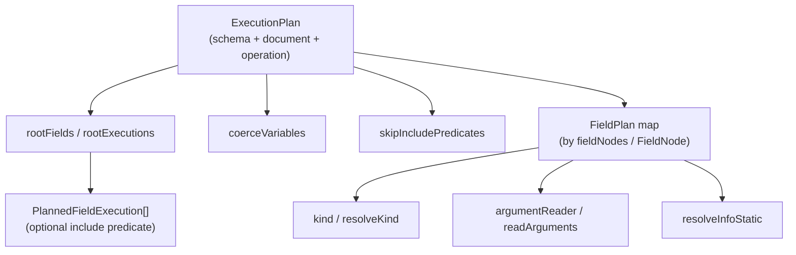
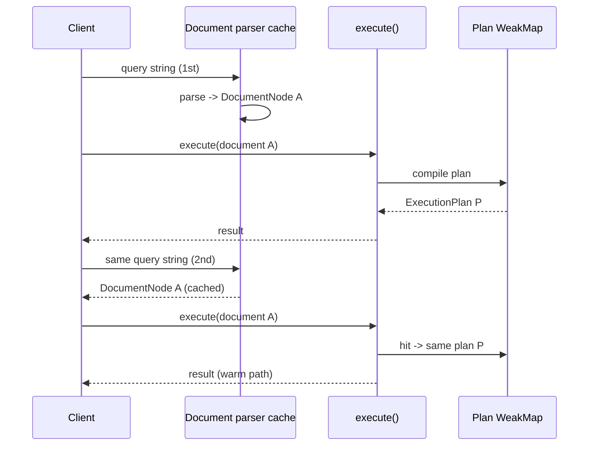

import { Callout } from '@theguild/components'

# Planned execution

`@graphql-tools/executor` compiles a cacheable **execution plan** for a GraphQL operation and reuses
it across repeated `execute` / `executeSync` calls. The plan is an in-memory structure the executor
interprets on the warm path.

On a warm hit, field collection, type classification, variable coercion, resolveInfo statics, and
safe argument reads are already prepared, so each request does less AST work.

## What is compiled

For an eligible `(schema, document, operationName)`, public `execute` get-or-compiles an
`ExecutionPlan`. You can also pass a precompiled plan alone (`execute({ plan, ... })`) — that path
trusts `plan.schema` / `plan.document` / `plan.operation` and must not also pass `schema` /
`document` / `operationName`. The warm interpreter holds:

| Piece                | Role                                                                                                                                                |
| -------------------- | --------------------------------------------------------------------------------------------------------------------------------------------------- |
| **Field maps**       | Pre-collected root / subfield maps (or a union over `@skip`/`@include` bool extremes)                                                               |
| **`FieldPlan`**      | Per-field static facts discriminated by `kind` (`leaf` / `leafList` / `object` / `abstract` / `list`), plus resolve kind, `resolveInfoStatic`, args |
| **Coercers**         | Plan-bound `coerceVariables` (empty / builtin-leaf / hoisted input-object closures) and per-field argument readers                                  |
| **Skip / include**   | Path-aware predicates on planned field executions when variables gate fields or fragments                                                           |
| **`rootExecutions`** | Bound root (and subfield) execution lists the warm path walks instead of re-collecting                                                              |

Documents that use `@defer` / `@stream` still compile per-field plan facts where useful; the
incremental interpreter remains the runtime for patches.




## Document parser cache

Plans are cached in a `WeakMap` keyed by **`DocumentNode` identity** (then schema, then operation
name). Pair with a **document parser cache** (for example Yoga's `useParserAndValidationCache`, or
Envelop's parser-cache plugin): the same query string keeps returning the same `DocumentNode`, so
the plan compiles once and is reused on later requests for that document.



<Callout type="info">
  Without a parser cache, each `parse(source)` allocates a **new** `DocumentNode`. The plan cache
  cannot hit across those identities. Pairing parser cache + plan cache is how servers stay on the
  warm path in production.
</Callout>

## How to use it

1. **Keep document identity stable**: use Yoga / Envelop parser cache, persisted queries, or any
   layer that returns the same `DocumentNode` for the same source.
2. **Call `execute`**: public `execute` / `executeSync` / `normalizedExecutor` get-or-compile a plan
   from `schema` + `document` (+ optional `operationName`). Or pass a precompiled `plan` alone for
   warm reuse. `ExecuteArgs` is the entry union (plan **or** schema+document). `ExecutionArgs` stays
   the document-mode interface so `interface X extends ExecutionArgs` keeps working.
3. **Treat schemas as immutable for plan cache**: the WeakMap keys on schema **identity**. Mutating
   resolvers or scalars on the same schema instance while reusing a cached plan is unsupported (no
   per-request schema fingerprint). Use a new schema object (or a new `DocumentNode`) after such
   changes.
4. **Treat plans as opaque**: `compileExecutionPlan` returns an opaque `ExecutionPlan` handle
   (TypeScript brand — no public Maps/arrays). The runtime shell is shallow-frozen; nested
   structures are **not** deep-frozen. Do not mutate a plan; prefer `execute({ schema, document })`
   unless you need plan-only warm reuse.

```ts
import { compileExecutionPlan, execute, isExecutionPlan } from '@graphql-tools/executor'

// Same DocumentNode identity → get-or-compile plan, then execute
const result = await execute({ schema, document, variableValues })

// Explicit compile + plan-only warm reuse (no schema/document on execute)
const plan = compileExecutionPlan({ schema, document })
if (isExecutionPlan(plan)) {
  const warm = await execute({ plan, variableValues })
}
```

## Why it helps (benchmarks)

Process-isolated microbenches vs `master` on Node 22 (separate process per side, warm plan).

| Bench                                          | Approx. delta vs master |
| ---------------------------------------------- | ----------------------: |
| Synchronous leaf list (1000)                   |              **~+210%** |
| Asynchronous leaf list (1000)                  |              **~+100%** |
| Asynchronous root fields (1000)                |               **~+85%** |
| Nested default-resolver objects (200)          |              **~+140%** |
| Dense `@skip` / `@include` variable fields     |              **~+45%+** |
| Default-resolver property bag (400 Int fields) |                   ahead |

**Why:** always-on planned execute, leaf-list / object-list thin walks, field-local async settle,
and String primitive fast-paths cut collect / resolveInfo / serialize work on the warm path.

Cold compile runs once per `(schema, document, operationName)` cache miss. Amortization against
classic is **not** the cold/warm ratio. Break-even request count is approximately
`N = ceil(T_compile / (T_classic − T_planned))` when classic warm is slower than planned warm.
`T_compile` is the one-time plan compile cost (cold first execute minus planned warm); include
classic warm time — a cold/warm wall-time ratio alone is only a compile-vs-warm illustration, not
amortization. Closer classic and planned warm times shrink the denominator and **raise** `N`, so
break-even can exceed the cold/warm ratio (e.g. cold≈100×warm while `N`≈200 when classic is only
slightly slower than planned). On a dense `@skip`/`@include` probe (Node 22, process-isolated), `N`
is often a few hundred executes. Retained heap grows with document complexity; the probe separates
AST retention from plan-incremental overhead across several plan counts (see
`scripts/measure-plan-cold-heap.mjs`). The numbers in the table above are warm-path deltas vs
master, not cold-start cost.

## Classic vs planned (module boundaries)

Planned execution is an **optimization layer** on top of classic completion — not a replacement.

| Layer               | Module(s)                             | Responsibility                                                             |
| ------------------- | ------------------------------------- | -------------------------------------------------------------------------- |
| Plan IR / cache     | `plan.ts`                             | Compile eligibility, `FieldPlan` kinds, WeakMap lifecycle, kill switch     |
| Orchestration       | `execute.ts`                          | Field walk, runners, thin leaf-list / object-list paths, classic fallback  |
| Shared semantics    | `completeShared.ts`                   | Leaf serialize (`completeLeafValue`) and list-item error localization only |
| Classic list/object | `execute.ts` (`completeListValue`, …) | Full classic interpreter; independent of plan cache                        |

**Invariants**

- Classic does not compile or consult plans when planning is disabled.
- Shared helpers stay semantic-only (no plan IR, no scheduling). Hot specialized paths stay in
  `execute.ts` when extracting them would regress throughput.
- Fallback / mid-list resume must not replay getters, resolvers, or serializers already observed.
- Leaf lists complete **one slot at a time**: a sync NonNull failure leaves later accessors unread;
  after an async serialize, unread later slots are read from the live result (serializer mutations
  match classic).

## Correctness: dual-mode classic vs planned

Public `execute` / `executeSync` plan by default. To re-run the existing executor **core**
correctness suite with planning disabled (classic interpreter only):

```sh
npm run test:executor:core         # planned (default)
npm run test:executor:core:classic # GRAPHQL_TOOLS_EXECUTOR_PLANNING=0
npm run test:executor:dual-mode    # both (also run in CI)
```

`setExecutionPlanningEnabled(false)` (or the env var above) makes `resolvePlanForExecute` a no-op so
the same assertions exercise classic completion. Prefer this over a second handwritten suite.

`setExecutionPlanningEnabled` is **process-global** (module scope), not a per-request
`ExecutionArgs` option. Concurrent requests in one process would race if you flipped it mid-flight;
use the env var for a process-wide classic mode, or isolate processes when comparing modes. Env
`GRAPHQL_TOOLS_EXECUTOR_PLANNING=0` wins at module load; runtime `setExecutionPlanningEnabled`
overrides afterward for the process. Existing cached plans are unused while planning is off (classic
path never looks them up); turning planning back on may reuse WeakMap entries still reachable via
document/schema identity.


