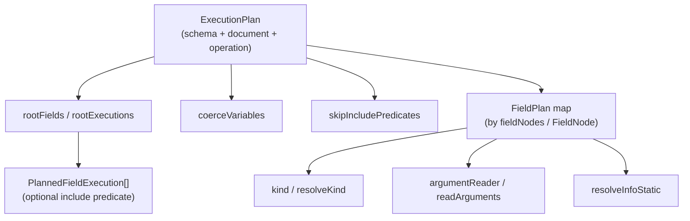
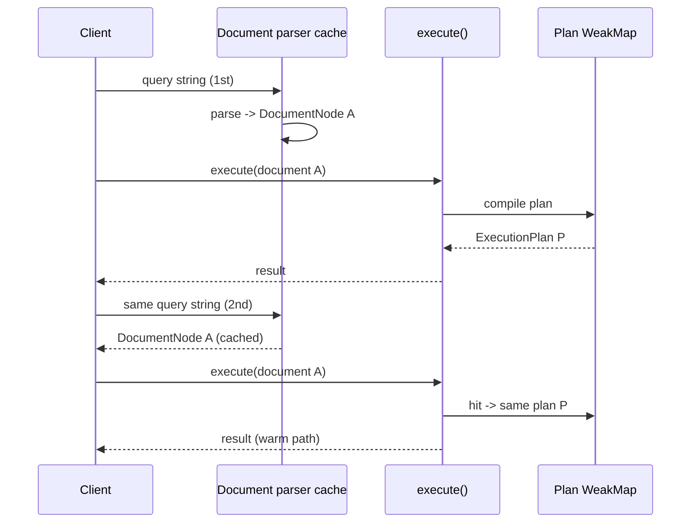

import { Callout } from '@theguild/components'

# Planned execution

`@graphql-tools/executor` compiles a cacheable **execution plan** for a GraphQL operation and reuses
it across repeated `execute` / `executeSync` calls. The plan is an in-memory structure the executor
interprets on the warm path.

On a warm hit, field collection, type classification, variable coercion, resolveInfo statics, and
safe argument reads are already prepared, so each request does less AST work.

## What is compiled

For an eligible `(schema, document, operationName)`, public `execute` get-or-compiles an
`ExecutionPlan` (or uses `args.plan` when you pass one from `compileExecutionPlan`). WeakMap /
FieldPlan indexes use a `__` prefix (`__fieldPlanByNodes`, …). The warm interpreter holds:

| Piece                | Role                                                                                                                                                |
| -------------------- | --------------------------------------------------------------------------------------------------------------------------------------------------- |
| **Field maps**       | Pre-collected root / subfield maps (or a union over `@skip`/`@include` bool extremes)                                                               |
| **`FieldPlan`**      | Per-field static facts discriminated by `kind` (`Leaf` / `LeafList` / `Object` / `Abstract` / `List`), plus resolve kind, `resolveInfoStatic`, args |
| **Coercers**         | Plan-bound `coerceVariables` (empty / builtin-leaf / hoisted input-object closures) and per-field argument readers                                  |
| **Skip / include**   | Path-aware predicates on planned field executions when variables gate fields or fragments                                                           |
| **`rootExecutions`** | Bound root (and subfield) execution lists the warm path walks instead of re-collecting                                                              |

Documents that use `@defer` / `@stream` still compile per-field plan facts where useful; the
incremental interpreter remains the runtime for patches.




## Document parser cache

Plans are cached in a `WeakMap` keyed by **`DocumentNode` identity** (then schema, then operation
name). Pair with a **document parser cache** (for example Yoga's `useParserAndValidationCache`, or
Envelop's parser-cache plugin): the same query string keeps returning the same `DocumentNode`, so
the plan compiles once and is reused on later requests for that document.



<Callout type="info">
  Without a parser cache, each `parse(source)` allocates a **new** `DocumentNode`. The plan cache
  cannot hit across those identities. Pairing parser cache + plan cache is how servers stay on the
  warm path in production.
</Callout>

## How to use it

1. **Keep document identity stable**: use Yoga / Envelop parser cache, persisted queries, or any
   layer that returns the same `DocumentNode` for the same source.
2. **Call `execute`**: public `execute` / `executeSync` / `normalizedExecutor` get-or-compile a plan
   when `plan` is omitted. You can also call `compileExecutionPlan` once and pass
   `execute({ plan, ... })` for warm reuse.
3. **Prefer stable schemas**: plans close over field configs; if you mutate a schema object in
   place, use a new schema identity (or a new `DocumentNode`) so stale plans are not reused.

```ts
import { compileExecutionPlan, execute, isExecutionPlan } from '@graphql-tools/executor'

// Same DocumentNode identity → get-or-compile plan, then execute
const result = await execute({ schema, document, variableValues })

// Explicit compile + warm reuse
const plan = compileExecutionPlan({ schema, document })
if (isExecutionPlan(plan)) {
  const warm = await execute({ schema, document, plan, variableValues })
}
```

## Why it helps (benchmarks)

Process-isolated microbenches vs `master` on Node 22 (separate process per side, warm plan).

| Bench                                          | Approx. delta vs master |
| ---------------------------------------------- | ----------------------: |
| Synchronous leaf list (1000)                   |              **~+210%** |
| Asynchronous leaf list (1000)                  |              **~+100%** |
| Asynchronous root fields (1000)                |               **~+85%** |
| Nested default-resolver objects (200)          |              **~+140%** |
| Dense `@skip` / `@include` variable fields     |              **~+45%+** |
| Default-resolver property bag (400 Int fields) |                   ahead |

**Why:** always-on planned execute, leaf-list / object-list thin walks, field-local async settle,
and String primitive fast-paths cut collect / resolveInfo / serialize work on the warm path.


